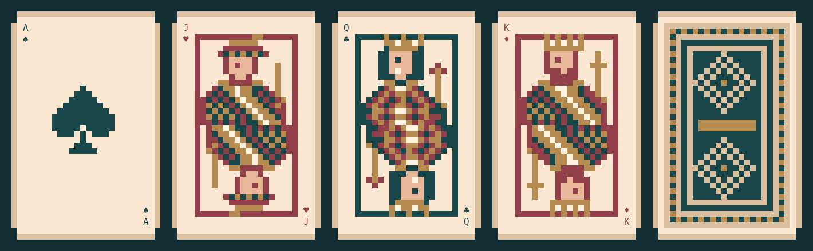

# Cardboard

Cardboard is a small Go library for playing-card state and terminal rendering. It provides cards, piles, player hands, dealing, drawing, reordering, face-up/down state, and the pixel-art renderer. Game rules belong in the game that imports it.



Requires Go 1.24 or newer and a terminal with truecolor and Unicode support.

## Try it

```sh
go run ./cmd/table
go run ./cmd/table --gallery
go run ./cmd/table --deal --players 3 --cards 7 --jokers 2
go run ./cmd/table --interactive --players 2 --cards 13 --jokers 2
```

The text deal is useful for checking distribution without ANSI card art. Interactive mode needs a real terminal and at least 28 columns by 29 rows for an overlapping hand.

Interactive controls:

| Key | Action |
| --- | --- |
| Left / right, or h / l | Select a card, or carry the picked card through the hand |
| Space / Enter | Pick up or place a card |
| Escape | Return the carried card to its original position |
| Tab / Shift+Tab | Switch between player hands and the common pile |
| f | Flip the focused pile |
| c | Switch between overlapping and grid layouts |
| d | Draw one card into the focused player's hand |
| q / Ctrl+C | Quit |

The interactive command is an example client. It does not contain turn order, meld checks, scoring, or other Rummy rules.

## Install

```sh
go get github.com/DukeAvi/cardboard
```

The package name is `cardboard`:

```go
package main

import (
	"fmt"
	"log"

	"github.com/DukeAvi/cardboard"
)

func main() {
	table := cardboard.NewTable()
	if err := table.AddJokers(2); err != nil {
		log.Fatal(err)
	}
	table.Shuffle()

	if err := table.Deal(2, 13); err != nil {
		log.Fatal(err)
	}

	hand, err := table.Hand(0)
	if err != nil {
		log.Fatal(err)
	}

	if err := hand.Move(0, 5); err != nil {
		log.Fatal(err)
	}
	hand.SetFaceDown(false)

	renderer := cardboard.NewRenderer(cardboard.Vintage)
	fmt.Println(renderer.Pile(hand, cardboard.View{
		Width:    100,
		Layout:   cardboard.Overlap,
		Selected: 5,
	}))
}
```

## State model

`Table` owns the common pile and all player hands. A new table starts with an ordered standard deck in its face-down common pile. Shuffling is explicit, so tests and games can choose when it happens.

```go
table := cardboard.NewTable()
table.Shuffle()
if err := table.Deal(2, 13); err != nil {
	log.Fatal(err)
}
```

`Deal` hands out one card at a time around the table. A failed deal leaves the table unchanged. Call `Reset` to collect every hand back into the common pile before dealing again. Previously returned hands are emptied by reset; fetch the new hands after the next deal.

```go
if err := table.Draw(0, 1); err != nil {
	log.Fatal(err)
}

table.Reset()
table.Shuffle()
```

Every collection of cards is a `Pile`. Index zero is its top card. `Cards` returns a copy, so callers cannot accidentally corrupt engine state.

```go
hand, _ := table.Hand(0)
common := table.Common()

top, err := common.Top()
if err != nil {
	log.Fatal(err)
}
fmt.Println(top, hand.Cards())

hand.Flip()
hand.SetFaceDown(true)
if err := hand.Move(2, 8); err != nil {
	log.Fatal(err)
}
if err := cardboard.Transfer(common, 0, hand, hand.Len()); err != nil {
	log.Fatal(err)
}
```

`Transfer` validates both indexes before changing either pile. Moving within one pile and transferring between piles preserve card count.

For repeatable shuffles in tests, use `ShuffleWith` and a seeded `math/rand/v2.Rand`.

### Custom decks

Use `NewTableWithDeck` for multiple decks or a different selection of cards. For example, two standard decks with four printed jokers:

```go
deck := append(cardboard.StandardDeck(), cardboard.StandardDeck()...)
for range 2 {
	deck = append(deck,
		cardboard.Card{Rank: cardboard.Ace, Suit: cardboard.Joker},
		cardboard.Card{Rank: cardboard.Two, Suit: cardboard.Joker},
	)
}
table, err := cardboard.NewTableWithDeck(deck)
if err != nil {
	log.Fatal(err)
}
table.Shuffle()
if err := table.Deal(6, 13); err != nil {
	log.Fatal(err)
}
```

The constructor validates and copies the supplied cards. It assigns each card a nonzero `ID` unique within that table, including cards with identical faces. IDs stay with the cards when they are shuffled, dealt, moved, or collected. Input IDs are replaced when constructing a table. `StandardDeck` and hand-written card values have no assigned ID.

Compare `ID` to track one physical card within a table. Use `card.SameFace(other)` to compare rank and suit without considering identity. IDs from different tables are not globally unique.

### Extra piles

Create a discard or other shared pile with `NewPile()` and move cards with `Transfer`. Index zero is always the top, so discarding onto a pile means inserting at index zero.

```go
discard, _ := cardboard.NewPile()
if err := cardboard.Transfer(hand, 3, discard, 0); err != nil {
	log.Fatal(err)
}
```

Extra piles belong to the caller. `Table.TotalCards()` and `Reset()` cover only the table's common pile and hands. Count extra piles separately, and transfer their cards back before resetting a round.

`FaceDown` controls rendering. It does not prevent code from reading `Cards()` or `At()`. Games control which hands players may inspect; a network game should send only the cards that each player is allowed to see. Piles and tables should be changed from one game loop, or protected by the caller when used concurrently.

## Cards

Ranks and suits use named constants:

```go
card := cardboard.Card{Rank: cardboard.Queen, Suit: cardboard.Hearts}

fmt.Println(card.Valid())  // true
fmt.Println(card.Short())  // QH
fmt.Println(card.String()) // Queen of Hearts
fmt.Println(card.Red())    // true
```

`StandardDeck()` returns a fresh ordered slice of 52 cards. The two printed joker faces use `Suit: cardboard.Joker` with ranks `Ace` and `Two`. `AddJokers(2)` adds them to a standard table; supply jokers directly to `NewTableWithDeck` when you need more than two.

## Selecting and carrying cards

`Selection` provides the cursor and carry behavior used by the interactive example. It has no keyboard or terminal dependencies, so another game can bind its own controls to it.

```go
selection := cardboard.NewSelection(hand)
if err := selection.Pick(); err != nil {
	log.Fatal(err)
}
if err := selection.Move(1); err != nil {
	log.Fatal(err)
}
if err := selection.Place(); err != nil {
	log.Fatal(err)
}
```

`Move(-1)` and `Move(1)` browse the pile when idle and move the actual card when carrying. Movement stops at either end. `Place` keeps the new order; `Cancel` restores the card's original position. Empty piles have selected index `-1`.

Create one selection per pile and retain it between inputs. If other code changes the pile during a carry, the next selection operation ends the carry and returns an error without moving another card.

Pass the selection state to the renderer:

```go
fmt.Println(renderer.Pile(hand, cardboard.View{
	Width:    100,
	Layout:   cardboard.Overlap,
	Selected: selection.Selected(),
	Picking:  selection.Carrying(),
	Picked:   selection.Picked(),
}))
```

## Rendering

The renderer produces ANSI strings. `Card` and `Back` render individual cards. `Pile` respects the pile's face-up/down state.

```go
renderer := cardboard.NewRenderer(cardboard.Vintage)

fmt.Println(renderer.Card(card))
fmt.Println(renderer.Back())
fmt.Println(renderer.Pile(hand, cardboard.View{
	Width:    100,
	Height:   50,
	Layout:   cardboard.Grid,
	Selected: 3,
	Picking:  true,
	Picked:   1,
}))
```

Available layouts are `Overlap`, `Grid`, and `Stack`. Selected cards receive a gold frame and a picked card receives a red frame. Set `Selected` to `-1` when no card should be highlighted.

Cards are 26 columns by 20 rows. Overlap and grid layouts add space for frames. Narrow views keep the selected card visible instead of shrinking the artwork.

`Theme` controls the eight-color palette. `Vintage` is the built-in theme.

## Test

```sh
go test ./...
go test -race ./...
go vet ./...
```

The tests cover custom decks, physical card identities, dealing order, invalid operations, drawing, resets, defensive copies, transfers, carry cancellation, hidden-card rendering, layout bounds, and interactive state. The custom-deck example is also compiled and run as a test.
